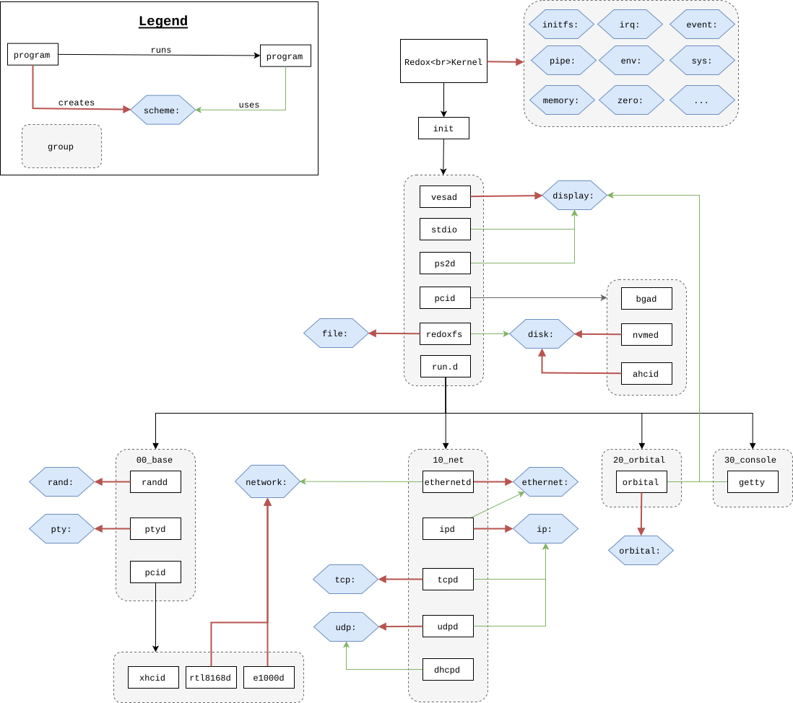

# Boot Process

This page follows a Ferric Oxide machine from firmware to the login prompt.
[Architecture: from firmware to user programs](./ferric-architecture.md#from-firmware-to-user-programs)
gives the same path in short, with source locations.

## Boot Loader

The boot loader is in `crates/bootloader/`.

### UEFI Boot

UEFI is the boot method Ferric Oxide develops for, on x86-64 and ARM64 (RISC-V
64-bit support is inherited and frozen). UEFI starts up in 64-bit mode, so the
boot process doesn't need multiple stages. The firmware finds the EFI System
Partition (ESP) on the storage device, then loads and executes a PE32+ UEFI
program, typically `/EFI/BOOT/BOOTX64.EFI`
([OSDev Wiki](https://wiki.osdev.org/UEFI#Bootable_UEFI_applications)).

The first code that runs in our boot loader is `pub extern "C" fn main()` in
`src/os/uefi/mod.rs`. From there it follows the common boot process below.

### BIOS Boot

BIOS boot code from Redox is still in `src/os/bios/` and the `asm/`
directory, but Ferric Oxide targets UEFI machines and does not develop or test
BIOS boot; the [roadmap](./ferric-roadmap.md#guiding-decisions) drops it. In
short: the firmware runs a stage 1 loader from the first sector of the disk,
which loads a stage 2 that switches the CPU from 16-bit real mode to protected
or long mode and runs the Rust stage 3, entering at `pub extern "C" fn start()`
in `src/os/bios/mod.rs` ([OSDev Wiki](https://wiki.osdev.org/Boot_Sequence#Master_Boot_Record)).

### Common boot process

The bootloader reads the memory map and sets the display mode, both of which
rely on firmware services that are gone once the kernel runs. It then finds
the RedoxFS boot partition on the disk and loads `/boot/kernel` and
`/boot/initfs` into memory. For a live image, it loads the whole partition into
memory first.

It then sets up the initial page tables and passes the kernel its environment,
including the location of the RedoxFS boot partition. With `kernel.kaslr_image`
(on by default) and an entropy source, the bootloader applies the kernel's
retained relocations and loads it at a randomized virtual address; otherwise
it uses the link address. Finally it jumps to the kernel's entry point.

## Kernel

The kernel is a single ELF program, `/boot/kernel`, built from
`crates/kernel/`. It performs architecture-specific initialization in `kstart`
(memory, CPU features, interrupts, and the mitigations described in
[Memory and CPU protection](./ferric-memory.md)) before jumping to `kmain`. It
then starts the user-space **bootstrap**, a small executable embedded with the
initfs that needs little parsing from the kernel.

Bootstrap publishes the kernel's schemes, sets up `/scheme/initfs` and the
initial namespace manager, and executes `init`. If the initfs contains a
`lib/trace.toml` (written by the `kernel.trace_initfs_*` options), bootstrap
turns those trace events on first, so early boot can be traced; see
[Kernel tracing](./ferric-tracing.md#the-initfs-trace-configuration).

The schemes the kernel provides include `memory`, `pipe`, `event`, `irq`,
`sys`, `time`, `debug`, `serio`, `kernel.acpi`, `kernel.dtb` and `kernel.proc`,
plus, when their options are on, `kernel.iommu`, `kernel.regbuf`,
`kernel.ring`, `kernel.pcache` and `kernel.trace`.

## Init

`init` (`userspace/base/init/`) starts services from **unit files**, similar to
systemd units: `.service` files describe a daemon (its command, arguments and
how it reports readiness, for example by registering a scheme) and `.target`
files group units. Units declare what they need with `requires_weak`, and init
starts them in dependency order.

Boot has two stages. The first runs from the initfs, a RAM disk in
`/boot/initfs`, and has to make the root file system reachable. The second runs
from the root file system.

### RAM disk stage

The initfs units come from `userspace/base/init.initfs.d/`. Init first starts
`00_runtime.target`, the services relibc needs, and then `90_initfs.target`,
which pulls in the rest:

1. `00_runtime.target`: `ipcd`, `logd` (`/scheme/log`), `nulld`, `zerod`,
   `randd` (`/scheme/rand`), `rtcd` (sets the clock from the real-time clock)
   and a `ramfs` instance for logging.
2. `10_inputd.service` and `20_graphics.target`: the input and virtual-terminal
   multiplexer, `vesad` (the firmware framebuffer) and `fbbootlogd`.
3. `40_drivers.target`: `lived` for live images, `ps2d`, `hwd` (ACPI or device
   tree), and `pcid-spawner --initfs`, which starts the storage drivers listed
   in `userspace/base/drivers/initfs.toml` (AHCI, IDE, NVMe, VirtIO and others).
4. `50_rootfs.service`: `redoxfs --uuid $REDOXFS_UUID file $REDOXFS_BLOCK`, which mounts the
   partition the bootloader chose as `/scheme/file`.

### Root file system stage

Init then switches its root to the file system: programs come from `/usr`, and
unit files from `/usr/lib/init.d` and `/etc/init.d`. The defaults are in
`userspace/base/init.d/`: `pcid-spawner` starts the remaining PCI drivers
(audio, network, USB and so on, configured in `/usr/lib/pcid.d` and
`/etc/pcid.d`), followed by networking, audio and the consoles. The image
configuration (`config/base.toml` and the chosen `config/<name>.toml`) decides
which packages and units are installed.

If the image has a desktop, the Orbital display server is started.

## Login

After the init processes have set up drivers and daemons, the user can log in to the system. The login program accepts a username, with a default user called `user`, prints the `/etc/motd` file, and then executes the user's login shell, usually `ion`. At this point, the user will now be able to access the [shell](./shell.md).

## Graphical overview

Here is an overview of the initialization process with scheme creation and usage. For simplicity's sake, we do not depict all scheme interaction but at least the major ones. It comes from Redox and predates the unit-file init, but the order of the main stages still holds.

## Boot process documentation

- [Boot process documentation](https://wiki.osdev.org/Boot_Sequence)
