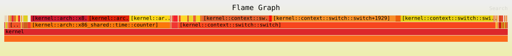

# Performance

- [Benchmarks](#benchmarks)
- [Profiling](#profiling)
- [Comparing commits](#comparing-commits)

## Benchmarks

### Quick checks

These shell commands give a rough idea of a machine's speed:

- CPU:

  ```sh
  dd bs=1M count=1024 if=/scheme/zero | sha256sum
  ```

- Memory:

  ```sh
  dd bs=1M count=1024 if=/scheme/zero of=/scheme/null
  ```

- File system write, then read (the read may come from a cache):

  ```sh
  dd bs=1M count=256 if=/scheme/zero of=bench_file conv=fdatasync
  dd bs=1M count=256 if=bench_file of=/scheme/null
  ```

- User-space IPC, many small requests through two scheme daemons:

  ```sh
  dd bs=4k count=100000 < /scheme/zero > /scheme/null
  ```

### Ferric Oxide benchmarks

Several image tests under `recipes/tests/` measure the new I/O paths and print
`FERRIC_BENCH` lines that CI collects:

- `ferric-iobench` runs fio-style read jobs on an NVMe disk and reports IOPS,
  bandwidth and latency percentiles, with the matching fio command for Linux
  ([Disk benchmark](./ferric-io.md#disk-benchmark-ferric-iobench)). For example,
  `ferric-iobench --rw=randread --bs=4k --iodepth=8`.
- `ferric-ring-test` times operations through a `kernel.ring` ring against the
  same system calls.
- `ferric-pcache-test` compares reads served by the page cache with reads
  served by RedoxFS in the same boot.
- `ferric-blkgrant-test` compares a copying disk read with DMA into a
  registered buffer.
- `ferric-netq-test` compares kernel-bypass transmission with netstack.
- `ferric-trace-bench` measures what tracing costs when compiled in but off,
  and with every event on.

Include the recipe in your image configuration to run one by hand. Benchmarks
in QEMU compare two setups in the same boot well, but their absolute numbers
say little about real hardware.

## Profiling

### Sampling profiles with `ferric-trace`

With `kernel.profiling` on, the kernel samples every CPU on a timer, and
`ferric-trace` records the samples and draws a flamegraph that covers both
kernel and user code. On x86-64:

1. Turn on the profiler, process image records and frame pointers, and build:

   ```sh
   cargo run -q -p ferric-config -- set kernel.profiling=true kernel.sys_proc=true cpu.frame_pointers=true
   cargo xtask build
   ```

   `kernel.profiling` cannot be combined with `kernel.trace` yet. Include the
   `ferric-trace` package in the image.

2. In the VM, as root, profile a command or a period of time:

   ```sh
   ferric-trace profile prof/ -- ion -c 'ls -R /usr > /dev/null'
   ferric-trace profile prof/ --seconds 5
   ```

3. Copy `prof/` to the host and draw it:

   ```sh
   ferric-trace flamegraph prof/ --kernel kernel.all --root build/x86_64/<config>/sysroot \
       --folded prof.folded -o prof.svg
   ```

[Sampling profiles](./ferric-tracing.md#sampling-profiles) explains the
options, how addresses are symbolized under KASLR and ASLR, and the limits.
For a timeline of system calls, scheme requests and context switches rather
than samples, see [System Call Tracing](./syscall-debug.md).

### Inherited: `make flamegraph`

The Makefile still has Redox's profiling targets, which create a flamegraph showing the kernel's most frequent operations, using time-based sampling.

This is an example flamegraph. If you open the image in a new tab, there is useful mouse hover behavior.



The steps below are for profiling on `x86_64`, running in `QEMU`. It is possible to run the tests on real hardware, although retrieving the data require additional effort.

#### Setup

1. Open a terminal window in the repository root.

2. Install the tools: 

```sh
cargo install redox-kprofiling inferno
```

3. Rename the `kernel = {}` item at `config/base.toml` to `profiling-kernel = {}`

4. Add the `profiled` recipe to the `[packages]` section of your image configuration and run `make rp.profiled`:

```toml
[packages]
profiled = {}
```

5. Boot QEMU and use the `sudo kprof_record <app-command> [APP-ARGS...]` command to profile the kernel when running the specified application (can't be used with multiple applications in the same command).

6. (Optional) The following filesystem configuration is used for automated profiling: create the filesystem configuration (`config/my_profiler.toml`, for example) or adapt your existing configuration with the following content:

```toml
include = [ "minimal.toml" ]

# General settings
[general]
# Filesystem size in MiB
filesystem_size = 256

# Package settings
[packages]
bash = {}
profiled = {} # Profiling daemon
# Add any other recipes you need for testing here

[[files]]
path = "/usr/bin/perf_tests.sh"
data = """
#!/usr/bin/env bash
dd bs=4k count=100000 < /scheme/zero > /scheme/null
"""

# Script to perform performance tests - add your tests here
# If you will be testing manually, you don't need this section
[[files]]
path = "/usr/lib/init.d/99_tests"
data = """
echo Waiting for startup to complete...
sleep 5
echo
echo Running tests...
kprof_record /usr/bin/perf_tests.sh
echo Shutting down...
shutdown
"""
```

7. (Optional) In the repository root, create the file `.config` with the following content:

```make
# This needs to match the name of your image configuration file
CONFIG_NAME=my_profiler
# QEMU core count, add if you want to increase the default core count (4)
QEMU_SMP=5
# Don't use the QEMU GUI
gpu=no
```

8. In the repository root, run the `make r.profiling-kernel,profiled image` command.

#### Making the flamegraph

**QEMU can't be running during this step, verify if it's closed beforehand to prevent data corruption**

9. The `make flamegraph` command will create a SVG of profiling data collected inside the VM, the SVG location is: `build/flamegraph/$(TARGET)-$(CONFIG_NAME)-kflamegraph.svg`

Use the `KPROF_OPTIONS=option-value` environment variable to determine what formatting options you want for your flamegraph:

- 'i' for relaxed checking of function length
- 'o' for reporting function plus offset rather than just function
- 'x' for both grouping by function and with offset

Replace the "option-value" with your preferred formatting options.

Example:

```sh
make flamegraph KPROF_OPTIONS=xo
```

10. View your flamegraph SVG in a web browser.

```sh
firefox build/flamegraph/$(TARGET)-$(CONFIG_NAME)-kflamegraph.svg
```

#### Real hardware

TODO: test

Boot the system, and when you're done profiling, kill `profiled` and extract the `/root/profiling.txt` file (Details TBD)

## Comparing commits

To measure improvements or detect regressions.

This inherited procedure compares kernel commit A against commit B with the `acid` benchmarks. For the Ferric Oxide benchmarks above, run the image tests on both commits and compare the `FERRIC_BENCH` lines; the per-CPU queue and page cache tests already pair their A and B runs within one boot.

1. Checkout commit A, rebuild recipe (`make cr.kernel`), and login as `root` user

2. Run one of the following commands and shutdown once finished:

```sh
kprof_record ACID_BENCH_OUTPUT=acid.txt
```

```sh
acid ACID_BENCH_OUTPUT=acid.txt
```

3. Run `make acid-output` and `make rotate-acid-output`

4. Checkout commit B, rebuild recipe (`make cr.kernel`), login as `root` user, and repeat step 2

5. Run `make acid-output` and `make compare-acid-output`

The comparison data is stored at: `build/$ARCH/$CONFIG_NAME/acid-output` (newer) and `build/$ARCH/$CONFIG_NAME/acid-output.old` (older)